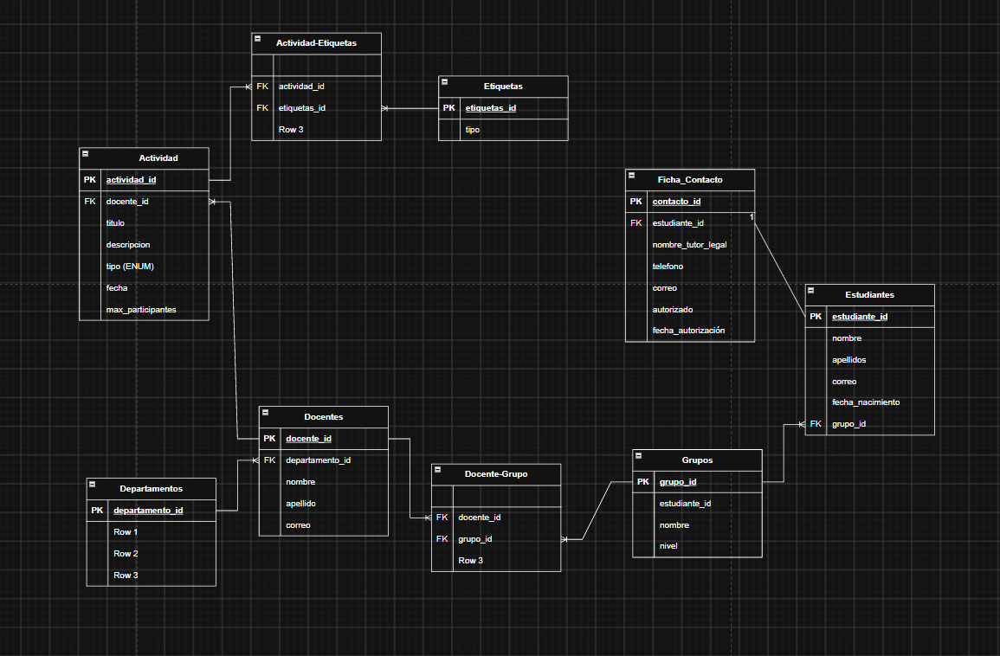

## Decisiones tomadas día a día.

fecha: 06/11/2026

Hoy hemos tomado las decisiones sobre como distribuir las tablas y entidades.

PostgresSQL --> Departamentos, Docentes, Grupos, Estudiantes, Etiquetas, Contactos, Actividad
MongoDb -->  Registros
Redis --> Memoria caché --> Todo lo que queramos ver instantáneamente --> Datos temporales

Relaciones SQL

    Departamento 1:N Docentes

	docentes N:M  grupos -->  Tabla intermedia Docente-Grupo 

    Actividad M:N etiquetas → Tabla intermedia Actividad-Etiqueta

	Grupo 1:N Estudiantes

	Estudiantes 1:N Contactos

	Docentes 1:N Actividades

    Grupos 1:N Actividades

---

fecha: 12/11/2026

Hoy hemos pasado las relaciones a draw.io en 

---

Además hemos decidido como ibamos a guiar el proyecto, teniendo en cuenta que somos 3:

| Integrante | Área | Resumen |
| --- | --- | --- |
| David Muñoz | Organización y alumnos | Departamento, Docente, Grupo, Estudiante y ficha de contacto |
| David Pino | Actividades e inscripciones | Actividad, Inscripción, aforo con bloqueo, historial y detalle |
| Pablo Sosa | Etiquetas, Mongo y calidad | Etiquetas (N:M), seguimientos en MongoDB, tests finales y documentación. |

